# 雾港来信 / Letters from Mist Harbor

An original Furry visual novel built with Ren'Py and AI-assisted development.

> 当前版本：**V0.1 原型**（可从头玩到三个结局之一并回到主菜单）

## 项目介绍

雾气弥漫的港口城市“雾港”。年轻的狼族信使**灰舟**接到一封没有寄信人、收信人是“灯塔看守人”的神秘信件；
送信途中，他在栈桥遇到熟悉港口秘密的狐狸**林岚**。玩家通过三次选择决定是否信任她，并逐步揭开十年前“雾钟号”沉没事件背后被搁置的那封信。

- 原创剧情、原创角色、原创占位美术（见下文“素材说明”）
- 流程约 2000 字中文文本，预计一次游玩 3–5 分钟（按文字量估算，未做真人计时）
- 本仓库的目标是展示 Ren'Py 开发能力，后续版本将在 V0.1 的结构上继续迭代

## 技术栈

| 项目 | 说明 |
| --- | --- |
| 引擎 | Ren'Py 8.x（开发与验证使用 8.3.7） |
| 脚本 | Ren'Py Script（`.rpy`），少量 Python（信任度辅助函数） |
| 素材生成 | Python 3 + Pillow（仅 `tools/`，**不是**游戏运行依赖） |
| 界面 | Ren'Py 官方示例项目 `the_question` 的 GUI 模板（1280×720），自制主菜单/游戏菜单背景与窗口图标 |
| 字体 | 思源黑体 Lite（`SourceHanSansLite.ttf`，SIL OFL 1.1，取自 Ren'Py SDK 的 `sdk-fonts`） |
| 本地化 | 默认简体中文界面，`game/tl/schinese/` 来自 Ren'Py SDK 自带的官方中文翻译 |

## 游戏功能（V0.1）

1. 两位角色：灰舟（狼）、林岚（狐），均用 `Character` 定义并带颜色名牌
2. 三个不同背景：雾中栈桥、旧信使公会后巷、夜晚灯塔
3. 狼、狐立绘各有两种表情（灰舟：平静/忧虑；林岚：平静/微笑），可由 `hz worried "…"` 方式切换
4. 三次玩家选择（共 3 个 `menu`）
5. `default trust = 0` 初始化信任度；每个选项通过 `change_trust()` 增减，并弹出提示（不暴露具体数值）
6. 用 `if / elif / else` 与 `jump` 按信任度分流；另有 `refused_guide`、`seal_shown` 两个剧情标记影响对白
7. 三个结局（均有结局卡片并正常 `return` 回主菜单）：
   - 信任度 ≥ 4：**结局一：灯塔回信**
   - 信任度 1–3：**结局二：半盏灯火**
   - 信任度 ≤ 0：**结局三：雾中错过**
8. 转场与动画：`fade` / `dissolve` / 自定义 `Fade`；角色滑入用 ATL `transform`；灯塔点亮闪光
9. 信封预览用自定义 `screen letter_card`，可扩展为物品栏
10. 使用 Ren'Py 自带的存档/读档、回退、历史、快进、自动前进、设置、帮助等功能
11. 用 `persistent.endings_seen` 记录已达成结局，为以后的结局回顾界面预留

选项与信任度（初始 0，三次选择各自增减）：

| 选择 | 选项 | 信任度 |
| --- | --- | --- |
| 1 栈桥 | 请她带路 / 追问她为何帮忙 / 拒绝并独自去找路 | +2 / +1 / −2 |
| 2 后巷 | 让她看火漆印 / 只说收信人 / 拒绝给任何人看 | +2 / 0 / −2 |
| 3 灯塔 | 愿意交给收信人 / 先问收信人是谁 / 不交给没证明身份的人 | +2 / 0 / −2 |

## 运行方法

1. 从 [Ren'Py 官网](https://www.renpy.org/latest.html) 下载 Ren'Py 8.x SDK 并解压
2. 打开 Ren'Py Launcher，将本仓库的**上级目录**设为 Launcher 的项目目录（仓库根目录即项目目录，`game/` 位于其下），刷新后即可看到该项目
3. 在 Launcher 中选中“MistHarbor-FVN”，点击“启动项目”

命令行方式：

```bash
./renpy.sh /path/to/MistHarbor-FVN          # 运行游戏
./renpy.sh /path/to/MistHarbor-FVN lint     # 语法 / 引用检查
```

辅助脚本：

```bash
python3 tools/check_project.py              # 静态检查 label/jump/图片/变量（无需 SDK）
pip install pillow && python3 tools/generate_assets.py   # 重新生成占位素材
```

Ren'Py 内置自动化测试（需要图形环境，每条路径对应一个结局）：

```bash
./renpy.sh /path/to/MistHarbor-FVN test path_true
./renpy.sh /path/to/MistHarbor-FVN test path_half
./renpy.sh /path/to/MistHarbor-FVN test path_miss
./renpy.sh /path/to/MistHarbor-FVN test save_load   # 存档 / 读档
./renpy.sh /path/to/MistHarbor-FVN test restart     # 返回主菜单后重新开始
```

## Windows 发行包与试玩

- **发行包**：用 Ren'Py 官方 `distribute` 命令构建 `MistHarbor-0.1.0-win.zip`（约 30 MB，内含 `MistHarbor.exe`、Windows 版 Python 运行时、全部脚本/图片/字体）。
  压缩包不提交到 Git 仓库（二进制较大且可随时重建），获取与重建方法见 [docs/WINDOWS_PLAYTEST.md](docs/WINDOWS_PLAYTEST.md)。
- **自行构建**：Windows 上用 Launcher 的 “Build Distributions” 勾选 Windows 即可；Linux/macOS 可运行 `tools/build_windows.sh <SDK目录> [输出目录]`。
- **试玩清单**：[docs/WINDOWS_PLAYTEST.md](docs/WINDOWS_PLAYTEST.md) 面向零基础开发者，覆盖启动、对话、三条分支、存读档、重新开始、退出。

## 目录结构

```
game/
  script.rpy        主剧本：角色、图像、变量、三幕剧情、三个结局
  options.rpy       基础配置（名称、版本、默认语言、转场、存档目录）
  gui.rpy           GUI 配置（字体、颜色、尺寸 1280x720）
  screens.rpy       界面（对话、菜单、存档、设置等，来自官方模板）
  tests.rpy         Ren'Py 自动化测试用例（三条通关路径、存读档、重新开始）
  images/           游戏使用的背景与立绘（PNG）
  gui/              界面素材（主菜单/游戏菜单背景、图标为自制，按钮等为官方模板）
  fonts/            思源黑体 Lite 及其 OFL 许可文本
  tl/schinese/      Ren'Py 官方简体中文界面翻译
tools/
  generate_assets.py  用 Pillow 绘制占位素材（非运行依赖）
  check_project.py    静态检查脚本
  capture_screenshots.rpy  驱动真实剧情截图的辅助脚本（需临时复制到 game/，不提交到 game/）
  build_windows.sh    调用官方 distribute 构建 Windows zip（Linux/macOS）
docs/WINDOWS_PLAYTEST.md  Windows 运行/构建指南与试玩清单
docs/screenshots/     真实运行游戏时截取的截图
THIRD_PARTY_NOTICES.md  第三方内容（Ren'Py 模板、字体、翻译）的来源与许可
```

## 素材说明

- `game/images/` 下的背景与角色立绘、`game/gui/main_menu.png`、`game_menu.png`、`window_icon.png`
  全部由 `tools/generate_assets.py` 用 Pillow 绘制，原创、风格为简易占位图，后续会被正式美术替换。
- 界面按钮/滑条/文本框等基础图片、`screens.rpy`、`gui.rpy`、中文翻译文件来自 Ren'Py SDK 自带的官方项目模板
  （Ren'Py 以 MIT/LGPL 等许可发布），字体为 SIL OFL 1.1 的思源黑体。未使用来源不明的网络图片。
- V0.1 没有音乐与音效。
- 第三方内容的逐项来源与许可见 [THIRD_PARTY_NOTICES.md](THIRD_PARTY_NOTICES.md)。`the_question` 示例自带的第三方插画与头像已从仓库中移除。

## 实际测试状态（如实记录）

测试环境：Linux 云端虚拟机，Ren'Py **8.3.7**（官方 SDK `renpy-8.3.7-sdk.tar.bz2`，从 renpy.org 下载），
软件渲染（Mesa llvmpipe），无声卡。以下均为 AI Agent 在该环境中实际执行的结果（V0.1 验收阶段，2026-10-19）。

| 项目 | 结果 |
| --- | --- |
| `renpy.sh <项目> lint` | **已运行，退出码 0**：无错误、无警告，仅输出统计与一条通用建议（建议开启 `config.check_conflicting_properties`）。统计：83 个对话块、3 个菜单、24 个界面 |
| `python3 tools/check_project.py` | **已运行，通过**：9 个 label、7 个图像、2 个角色、4 个 default 变量 |
| `test path_true` | **通过**：到达 `ending_true`（`assert trust == 6`），回到主菜单后退出，退出码 0 |
| `test path_half` | **通过**：到达 `ending_half`（`assert trust == 1`），回到主菜单后退出，退出码 0 |
| `test path_miss` | **通过**：到达 `ending_miss`（`assert trust == -6`），回到主菜单后退出，退出码 0 |
| `test save_load` | **通过**：后巷处存档（trust=2）→ 继续选择使 trust=0 → 读档后 trust 回到 2，并能再次走完第二次选择（trust=4）。存/读档由 `FileSave`/`FileLoad` 动作触发 |
| `test restart` | **通过**：中途用 `MainMenu` 返回主菜单后再次“开始游戏”，`trust`、`refused_guide` 被重置 |
| Windows 发行包构建 | **已完成**：`renpy.sh launcher distribute <项目> --package win` 成功，生成 `MistHarbor-0.1.0-win.zip`（约 30 MB，1612 个文件，zip 完整性检查通过）。在 Linux 上交叉构建，使用 SDK 自带的 Windows 运行时 |
| 发行包内容检查 | **已完成**：包内含 `MistHarbor.exe`、`game/script.rpy(c)`、`options/gui/screens`、`game/images/` 全部 7 张图、`game/gui/`（含自制主菜单/游戏菜单背景与图标）、`game/fonts/`（思源黑体 + OFL.txt）、`game/tl/schinese/`、`THIRD_PARTY_NOTICES.md`、`lib/py3-windows-x86_64/`；**不含** `tests.rpy`、`docs/`、`tools/`、`README.md` |
| 对解压后的发行包做测试 | **通过**：把 zip 解压后，用 Ren'Py 8.3.7 **Linux 运行时**对包内 `game/` 运行 lint（无错误）和 path_true / path_half / path_miss / save_load / restart 五个测试（测试时临时把 `tests.rpy` 放入解压目录），全部通过。这证明包内脚本与资源完整，**但不等于 Windows 上能运行** |
| `MistHarbor.exe` 在真实 Windows 上启动 / 试玩 | **未验证**：构建环境为 Linux，没有 Windows 机器，也没有 Wine。需要人在 Windows 上按 [docs/WINDOWS_PLAYTEST.md](docs/WINDOWS_PLAYTEST.md) 验证 |
| 真实剧情截图 | **已完成**：由 testcase 驱动真实流程截取 15 张（见下），不含临时 label 截图 |
| 中文字体 | 已检查：剧本、选项、界面字符均在字体字库内；验收时发现结局卡片标题中的间隔号“·”显示为方块，已改为“：” |
| 选项遮挡立绘 | 已修复：选项原本盖住角色面部，现将选项下移到面部与对话框之间（`screens.rpy` 中 `choice_vbox`），截图确认不再遮脸，仍会盖住躯干部分 |
| 通过界面按钮手动点击“存档/读档/设置”页 | **未验证**（只测试了存档动作本身，没有用 testcase 点击存档页面的格子；设置页仅在上一阶段截图中见过） |
| 多次存档覆盖、自动存档、快速存档(F5/F9)、回滚 | **未验证** |
| 真人试玩与阅读时长 | **未进行**：3–5 分钟仅为按文字量的估算 |
| Ren'Py Launcher 图形界面导入、Launcher 里点 Build | **未验证**：只通过命令行 `renpy.sh` 运行/构建；项目为标准结构，理论上可导入 |
| macOS / Android / Web 构建 | **未验证**（未尝试） |
| 声音 | **未验证**（V0.1 无音频，测试环境也无声卡） |

### 截图

均为真实运行游戏时用 `renpy.screenshot` 截取（1280×720），位于 `docs/screenshots/`。
截图由 `tools/capture_screenshots.rpy` 驱动 testcase 走完真实剧情后截取（使用方法见该文件头部注释）。

| 主菜单 | 对话：林岚（微笑） |
| --- | --- |
| 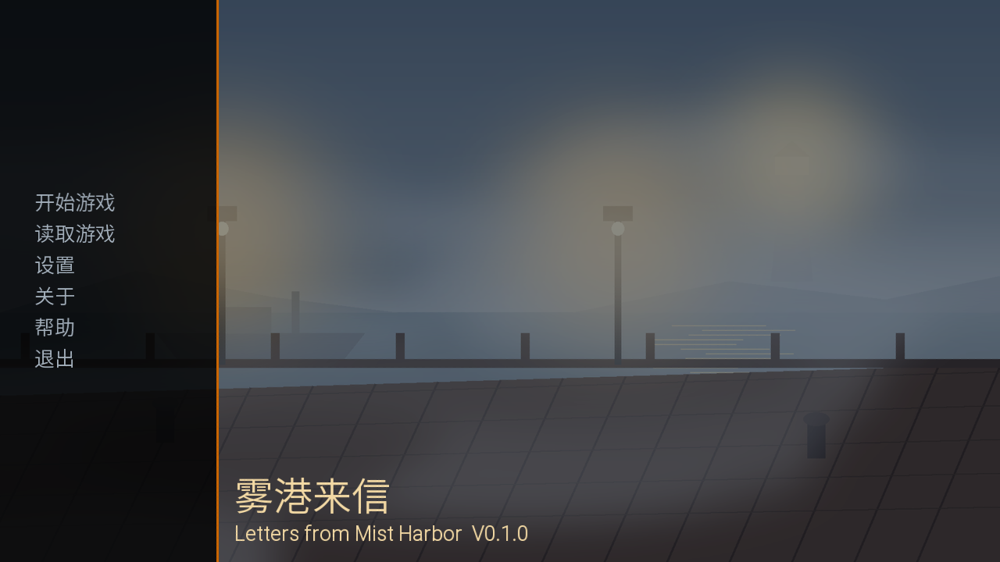 | 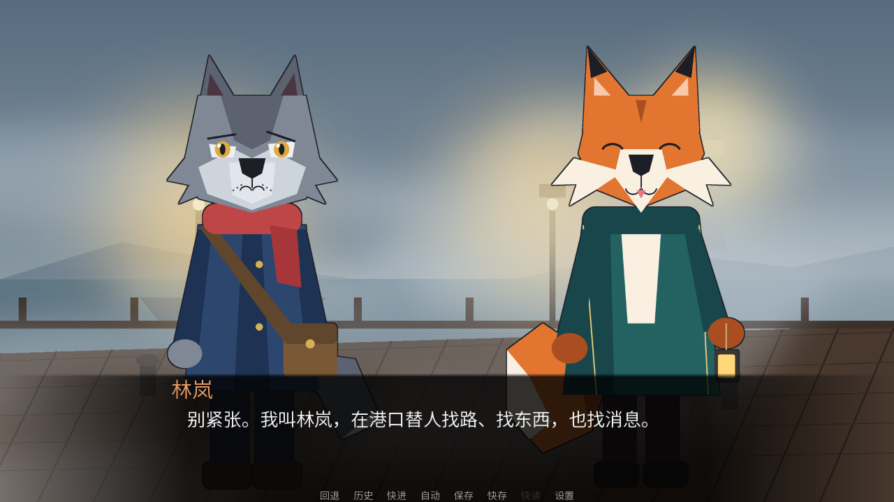 |

| 对话：灰舟（忧虑） | 信封预览 |
| --- | --- |
| 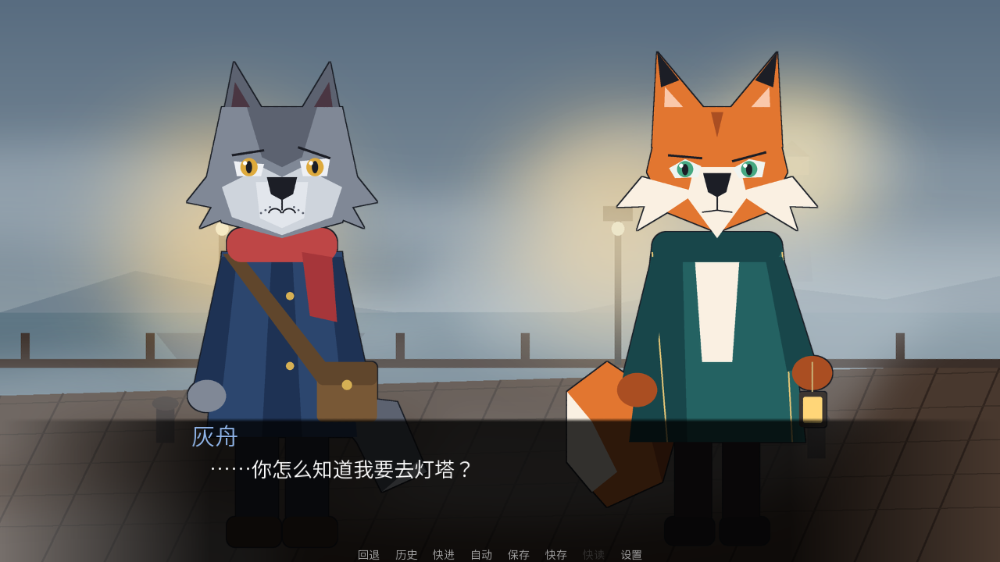 | 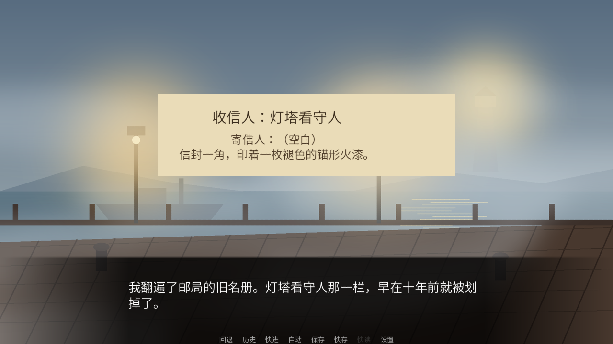 |

| 选择 1（栈桥） | 选择 2（后巷） |
| --- | --- |
| 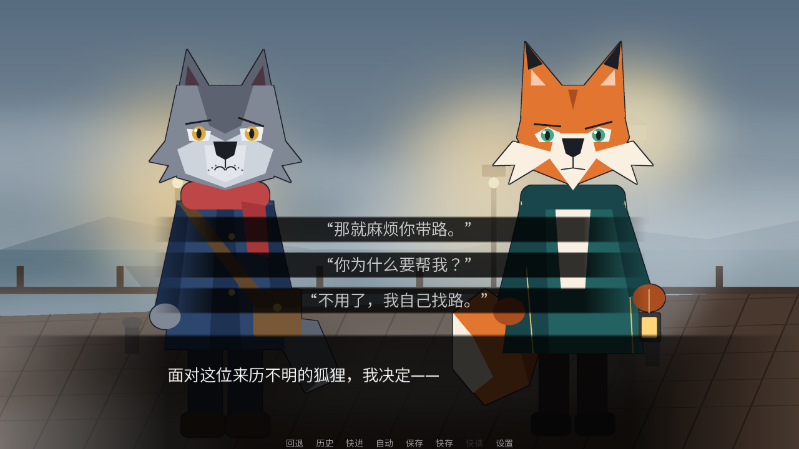 | 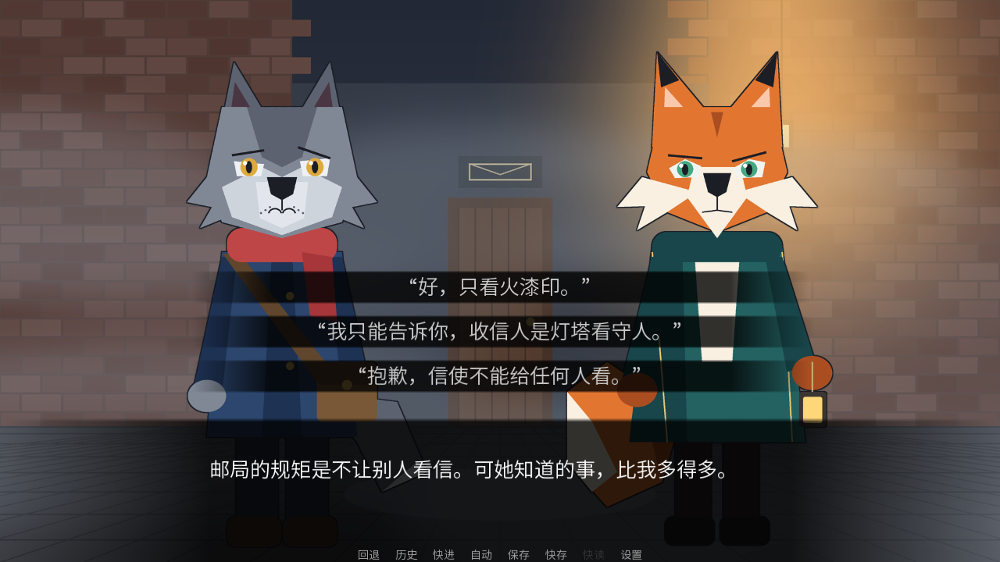 |

| 选择 3（灯塔） | 后巷 / 灯塔场景 |
| --- | --- |
| 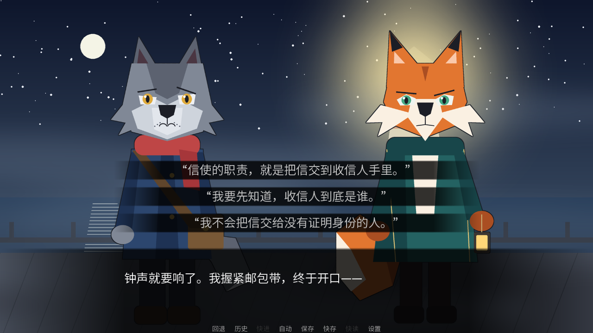 | 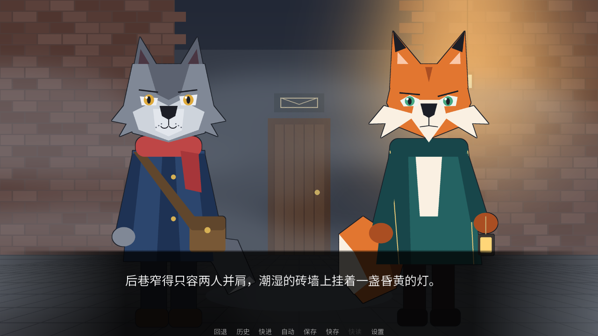  |

| 结局一对白 | 结局一卡片 |
| --- | --- |
|  | 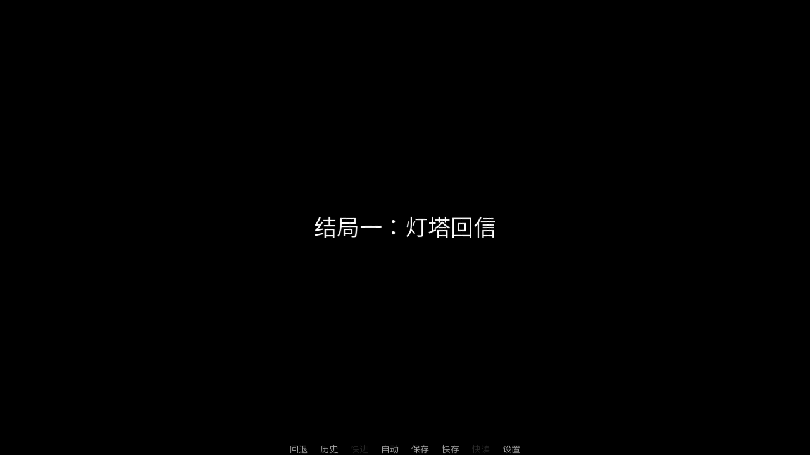 |

| 结局二对白 | 结局二卡片 |
| --- | --- |
|  | 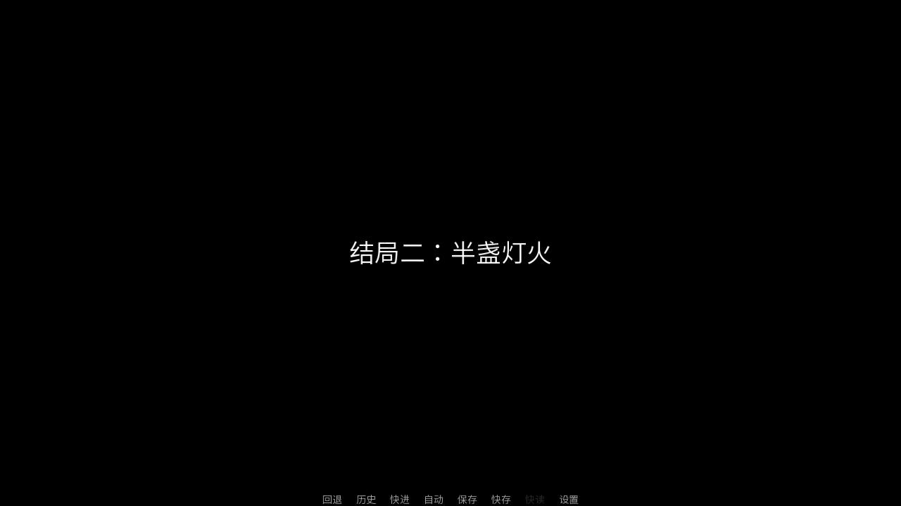 |

| 结局三对白 | 结局三卡片 |
| --- | --- |
| 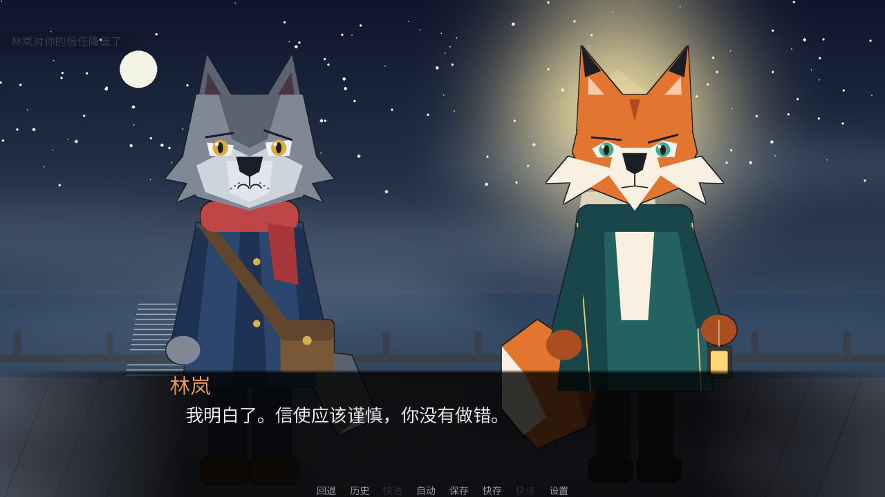 | 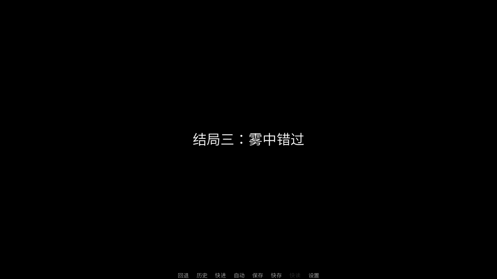 |

## 已知问题 / 限制

- 美术是代码绘制的简易占位图，立绘为静态、无口型与动作
- 选项菜单位于面部下方，仍会盖住立绘躯干部分（不遮脸）
- 界面（按钮、滑条等）沿用官方模板的橙色主题，仅调整了字体与部分颜色，尚未做统一视觉设计
- 无音乐、无音效；无 CG、无角色语音
- 结局回顾界面尚未实现（仅记录了 `persistent.endings_seen`）
- 默认文字速度为每秒 40 字，可在“设置”里调整
- 设置页中的语言列表含多种语言（来自官方翻译），选择非中文语言时剧情文本仍为中文

## 版本计划

- **V0.1（当前）**：可玩原型，两位角色、三个场景、三次选择、三个结局
- **V0.2**：自定义选项/对话框界面，加入背景音乐与基础音效，立绘增加更多表情与站位动画
- **V0.3**：结局回顾与章节选择界面，信件物品栏 / 线索笔记，增加支线与更多分支
- **V0.4+**：替换为正式美术，完善 UI 视觉，打包发布（Windows / macOS / Linux），英文本地化

## AI 辅助开发说明

本项目由 AI Agent（Cursor Cloud Agent）参与生成，包括：剧情文本、`.rpy` 脚本、素材生成脚本、静态检查脚本和本 README。
上文“实际测试状态”中的测试均由该 AI Agent 在云端虚拟机的命令行/软件渲染环境中执行并如实记录；
**没有任何未经验证的运行或测试被声称为已完成**。项目所有者尚未对游戏进行人工完整试玩与评审，
故内容和代码质量需要人工复核后才能作为最终作品使用。
